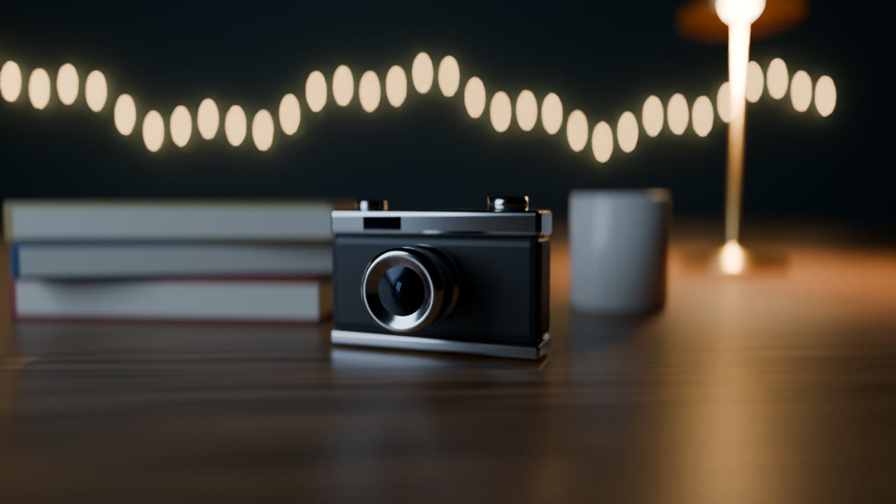
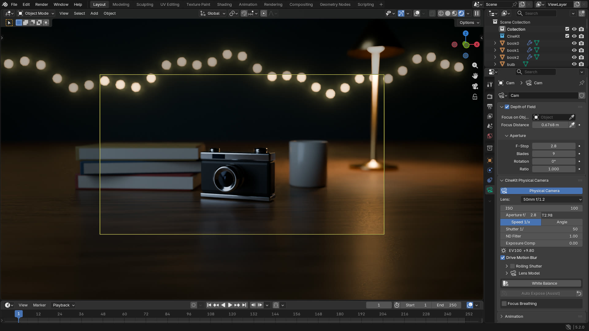
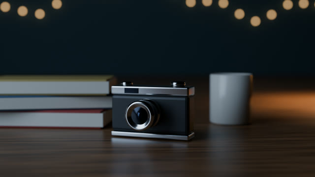
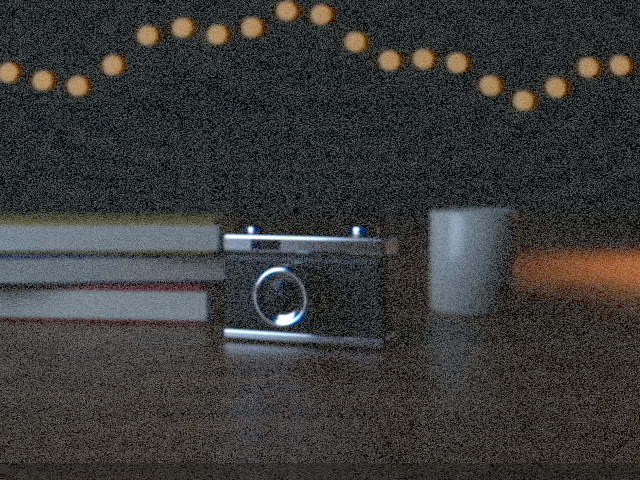
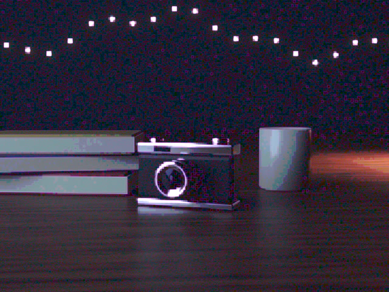
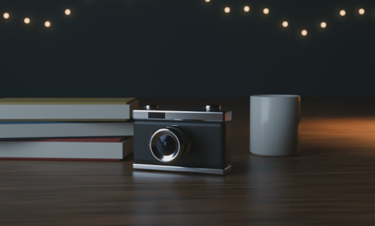
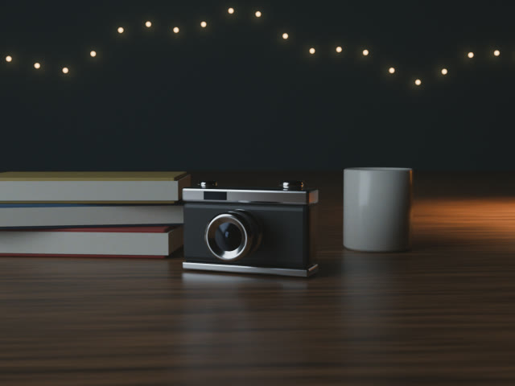
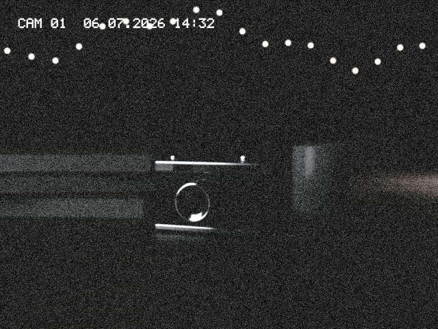
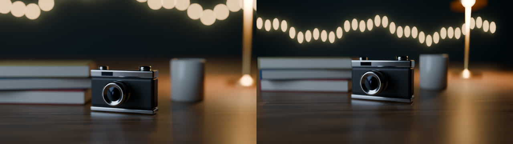
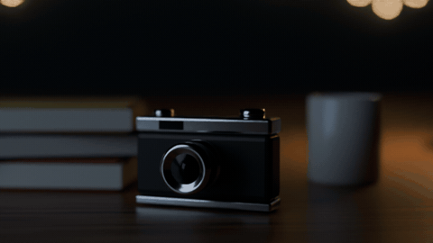

# CineKit

Make Blender cameras behave like real ones, then shoot through film and video looks built from optics rather than LUTs.



*A Cycles render through the 50mm 2x anamorphic preset.*

I made CineKit to bring cinematography tools to Blender, for cinema enthusiasts and VFX workflows. It's a free add-on for Blender 5.2 or newer, and it works in Cycles and EEVEE.



## Looks

One click sets the sensor size, aspect ratio, and compositor nodes together. Every effect has its own slider, and removing a look puts your scene back.

| | | |
|---|---|---|
|  |  |  |
| No look | VHS | Digicam 2005 |
|  |  |  |
| 16mm | Super 8 | Security Cam |

There's also Clean Digital, a neutral baseline with almost invisible grain.

## What else it does

- **Physical camera:** set ISO, aperture, and shutter, and the exposure follows. T-stops, ND filters, and white balance are included.
- **Lenses:** 17 presets with aperture blades, focus breathing, and lens softness. Anamorphic lenses give oval bokeh:

  

- **Focus:** click to focus, rack focus between two points, and a depth of field readout:

  

- **Rigs:** dolly, crane, handheld, and orbit. Adding a rig won't move your camera, and handheld shake goes on top of your animation.
- **Shots:** a shot list with a camera and look per shot, timeline markers, and batch render.
- **Lighting:** 7 setups, a mixer, 20 gobos, and light linking.

Details and the math are in the [reference](docs/REFERENCE.md).

## Install

1. Download the zip from [Releases](https://github.com/arazcreates/CineKit/releases). Don't unzip it.
2. In Blender, open *Edit > Preferences > Add-ons*.
3. Click the arrow at the top right, then *Install from Disk*, and pick the zip.

## Quick start

1. Press **N** in the 3D Viewport and open the **CineKit** tab.
2. In **Looks**, click **Apply Look** and pick VHS. The sensor and aspect ratio change right away.
3. Render. To see the full look in the viewport, set Viewport Shading > Compositor to **Always**.

## Known issues

- Only tested on Blender 5.2.
- The rolling shutter and light-node gobos need Cycles. EEVEE gets a shadow-plane gobo instead.
- Turn on *Render > Lock Interface* before rendering an animation with shot looks, or Blender can crash.
- With focus breathing on, Blender may print "Dependency cycle detected" in the console. The values are still correct.

Found another one? Please [open an issue](https://github.com/arazcreates/CineKit/issues).

## Contributing

Pull requests are welcome. Run the tests first:

```
python -m unittest discover tests
blender -b --factory-startup -P tests/smoke.py
```

## License

GPL-3.0-or-later, see [LICENSE](LICENSE). The gobo textures are CC0, so you can use them anywhere.

Made by **Araz Creates** ([araz.design3d@gmail.com](mailto:araz.design3d@gmail.com)). If you make something with CineKit, I would like to see it.
